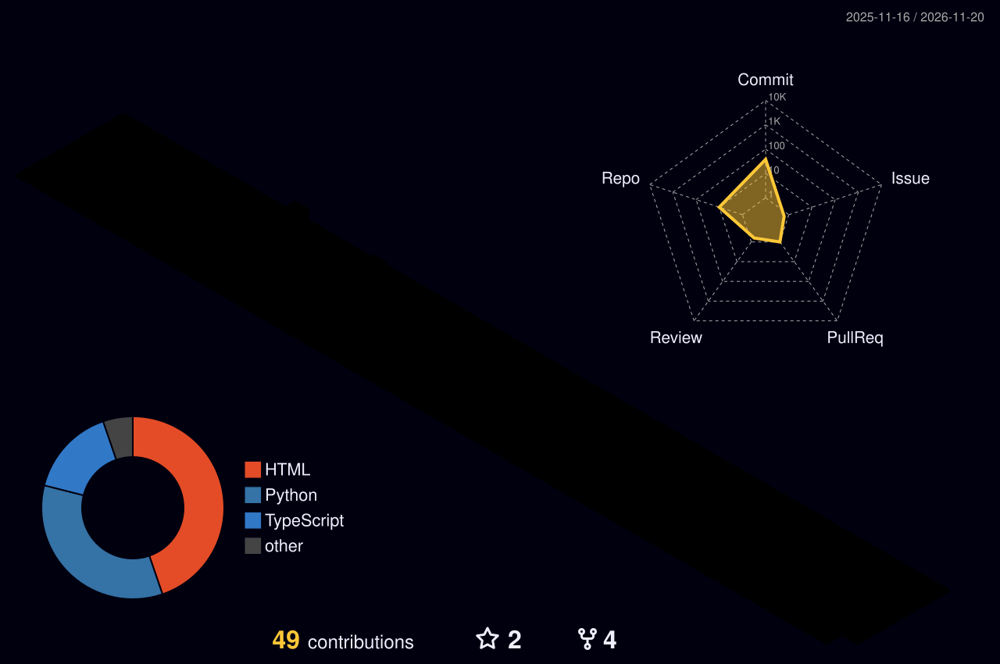
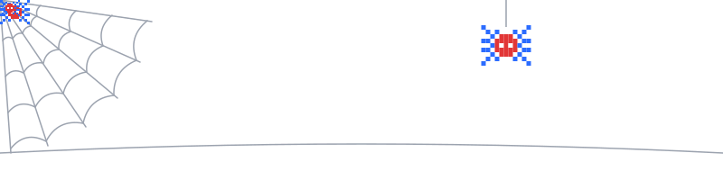

<!-- Palette: red #E23636 · deep red #B11313 · blue #2B6CFF · navy #0B1026 -->

<!-- Custom hero banner: assets/spider-hero.svg -->

  

<!-- Typing animation -->

  

  
  
  

## 🕸️ About me

Information Science Engineering graduate from Bengaluru, spinning ideas into working software with **Python, machine learning and AI application development**.

- 🧠 Hands-on with **LLM integration, document-analysis pipelines, evaluation rubric design and REST APIs**
- 🔬 Evaluating multilingual AI models as a **Generalist at Handshake AI**
- 🏅 Previously **RLHF Generalist → promoted to Reviewer** at Mercor Intelligence, with a 97%+ feedback approval rate
- 🎯 Looking to build and optimize practical AI solutions

## 🕷️ Experience

**Generalist (Contract) · Handshake AI** &nbsp;Oct 2026 – Present
- Write prompts in localized Indian English to evaluate multilingual AI models
- Compare two model variants side by side and write rationales for each rating

**RLHF Generalist & Reviewer (Contract) · Mercor Intelligence** &nbsp;Mar 2026 – Sep 2026
- Stress-tested 2 frontier LLMs per sprint with adversarial, multi-turn prompting across 7+ sprint cycles
- Promoted to Reviewer; quality-controlled peer evaluations while sustaining a **97%+ approval rate**
- Designed reusable system-prompt templates and evaluation rubrics covering 5+ scoring axes

## 🕸️ Projects I've spun

### 📑 AI-Powered Requirements Analysis Assistant
<!-- TODO: turn the title into a link to the repo: ### 📑 [AI-Powered Requirements Analysis Assistant](https://github.com/shreyasc84/REPO-NAME) -->

LLM-powered pipeline that reads requirement documents and turns them into structured data and diagrams.

- Extracts five requirement categories into structured, validated JSON using LangChain and Gemini
- FastAPI endpoints that auto-generate ER, class and wireframe diagrams with PlantUML

### 💰 [AI-Driven Personal Finance Advisor](https://github.com/shreyasc84/finance-advisor)

Upload a bank statement (PDF or CSV) and get categorized spending, a next-month forecast and personalized advice.

- Transaction pipeline with statement parsing, data normalization and feature engineering
- Ridge Regression forecasting with monthly lag features; TF-IDF + Logistic Regression transaction classifier
- LLM advisory layer for budget recommendations, savings insights and financial alerts

## 🧵 Threads in my web

**AI / ML**

**Backend · Frontend · Databases · Tools**

  
  &nbsp;&nbsp;
  

  
  &nbsp;&nbsp;
  

## 🏙️ My city of commits, in 3D

<!-- Generated daily by .github/workflows/profile-3d.yml -->

  

## 📊 GitHub dashboard

  
  

  

## 🕷️ Web crawlers

<!-- Static file in this repo: assets/spider.svg -->

  

## 🎓 Education & certificates

**B.Tech, Information Science Engineering** · Ramaiah University of Applied Sciences · 2022 – 2026 · **CGPA 8.49**

- Prompt Engineering & Programming with OpenAI
- NoSQL, Big Data, and Spark Foundations Specialization
- IT Fundamentals for Cybersecurity Specialization

## 🤝 Get caught in my web

Open to AI/ML and backend roles — reach me on **[LinkedIn](https://www.linkedin.com/in/shreyasc84)** or at **shreyasc84@gmail.com**.

<!-- Animated footer -->

  

